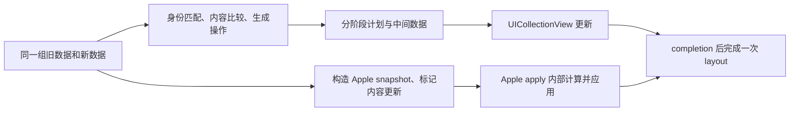

# Parade diff benchmark

2026-09-17 的第一轮 UI diff 实验。这里比较匹配计算成本、生成的 UI 操作数量，以及通过 UIKit 完成一次更新的成本。它是 Parade 选择 diff 方向的证据，不是公共 API，也不是生产选型结论。

这一轮覆盖 flat diff 的完整比较，以及 UIKit 上的单 section 更新；额外的 section 插入、重排和跨 section 身份场景也在这里，但自研 sectioned planner 尚未实现，不能用单 section 结果证明多 section 行为或性能。后续轮次按同样结构补进 `Benchmarks/`。

## 这是什么

目标是给现代 Swift / UICollectionView 列表库选择 diff 方向：比较匹配计算成本、生成的 UI 操作数量，以及通过 UIKit 完成一次更新的成本。这里的自研实现是实验候选，不是 Parade 的公共 API 或生产更新引擎。

已确认底层输入拥有稳定、全局唯一的展示 ID。上层只有 section 内唯一 ID 时，组合 `(sectionID, itemID)` 即可；实验使用 Int 和带 section 前缀的 String 两种输入。组合身份属于输入准备，不要求业务模型实现某个库的专用协议。真实 API 可使用强类型二元组封装，避免字符串拼接的歧义。

同一个展示 ID 跨 section 保持不变，表示同一身份移动；若 section 前缀改变，表示删除旧身份、插入新身份。两种场景分别测，不能用添加前缀悄悄改变前者的语义。

## 为什么是 build.py，不是 swift run

这轮要测 DifferenceKit 内部的 `diff` 和 `sourceTraces`，所以 `build.py` 把固定版本的 DifferenceKit 源码和本实验的 `Core.swift` 编进同一个 module；常规 SwiftPM 依赖只能访问公开 API，测到的就不是同一段工作。UIKit 部分还需要一个 iOS simulator app。因此这里用 `xcrun swiftc` 直接构建，不把 benchmark 挂进 Parade 的 `Package.swift`。

`Benchmarks/README.md` 也写了这一点：Parade 的 benchmark 是研究型 harness，不是 `swift run` 的 target。

## 比较口径



| 组别 | 候选 | 计时范围 |
|---|---|---|
| CPU / diff | DifferenceKit-core、Unique-Heckel、Key-LIS、Swift-difference | 从预生成的新旧模型计算同一坐标合同的 insert/delete/move/update；包括必要的 ID 提取、索引、内容比较和结果转换 |
| UIKit / backend | Apple-reload、Apple-reconfigure、DifferenceKit-staged、Unique-Heckel-staged、Key-LIS-staged | 准备 snapshot 或 staged changeset；逐阶段应用到实际挂在 window 上的 collection view；等待 completion；完成一次 layout |

Apple 没有公开独立返回 changeset 的纯 diff 接口，所以不进入 CPU 排名。snapshot 构造不等于 Apple 内部 diff。UIKit 结果记录 prepare、apply、layout 和 total，不能把 total 和 CPU diff 数值放在一列当成同一种工作。

DifferenceKit-core 调用固定 checkout 的内部 `diff`，把它的删除后 move 坐标转成原始 old 坐标；这项适配成本包含在 CPU 数据内。它不是上游公共 `StagedChangeset` 耗时，后者另在 UIKit prepare 中测量。所有候选与固定版本的 DifferenceKit 源码一起以相同优化配置编译；没有测跨模块派发差异。

DifferenceKit 的公共 changeset 仍由原库产生。UIKit 执行器在每个 stage 的 `performBatchUpdates` 完成后才继续，借此明确完成边界；不把上游没有 completion 的便利 `reload(using:)` 的返回时刻当成更新完成。自研候选共用实验性三阶段执行方式：内容 reload → 删除 → 插入和移动。记录的 stage 数属于这个完整 backend，不是算法的数学属性。

内容比较统一为同一 ID 的整数 revision 比较，刻意不混入图片、网络与复杂布局。Apple-reload 与其他候选均使用 reload 语义；Apple-reconfigure 单列，观察原生重配能力。后者的差异不能都归因于结构 diff。

## 算法与保证

- **Unique-Heckel**：针对唯一 ID 的匹配与 next-unconsumed-source 移动选择。省略重复值匹配，不承诺最少 move。它与 DifferenceKit 是同一算法家族的实现对照，不是“新算法战胜旧算法”的预设。
- **Key-LIS**：相同身份/内容遍历后，在新序列中提取 survivor 的旧位置，求 LIS；有序 survivor 直接返回。一般重排为 O(n log n)，同序快路径 O(n)。这份实现尚未做共同前后缀裁剪等额外调优。
- **Swift-difference**：对 ID 调用 `difference(from:).inferringMoves()`，再做内容比较。本地 Swift 源码 checkout 包含线性空间 Myers；实际被测的是当前 Xcode 附带标准库，不能声称它等于下载的 Swift main commit。
- **DifferenceKit**：固定 checkout 的优化 Heckel。上游说明允许重复标识时尽力匹配，但这轮合同明确唯一；重复标识不是这次性能比较的输入。

对单一线性序列、唯一 survivor、每次移动一个元素且 move 成本相同的模型，最少移动数是 `survivorCount - LCSLength`。唯一 ID 下可将 LCS 化为 LIS。这不意味着 LIS 使多 section UIKit 批次总成本最小，也不意味着最少 move 一定最少掉帧。

## 数据与可重复性

CPU 使用 100 / 1,000 / 10,000 / 100,000 元素，12 种场景：无变化、尾插、头插、删除、左旋一位、右旋一位、仅内容变化、相邻交换、完全打乱、逆序、全部替换、混合更新。增删改比例为约 5%；混合同时包含增删改与块移动。每份 fixture 在计时外构造，固定随机种子，所有候选拿相同数据。

CPU 每个组合 5 次预热、30 次正式样本；顺序按轮打乱，串行运行，记录中位数、p95 和原始样本。结果在计时外消费，避免未使用输出被整体消除；这不代表分配/析构、缓存或编译器影响完全消失。

为限制 Myers 大 edit-distance 的总运行预算，Swift-difference 不测 `n > 1,000` 的 shuffle/reverse/replace-all/mixed，也不测 100,000 元素组。JSON 明确写 `skipped-workload-budget`；跳过不算超时、失败或已测得的性能结论。

UIKit 使用 100 / 1,000 / 10,000 元素，7 个 flat 场景，另有 4 个 10×100 元素的 section 场景。每项 3 次预热、15 次正式样本，串行且按轮打乱 backend 顺序。每个样本使用新 collection，初始状态建立不计时；固定 cell 和 flow layout、关闭动画和 prefetch。完成 callback 后调用 `layoutIfNeeded`，这仍不等于像素已经呈现，更不是 frame/hitch 测量。

CPU 与 UIKit 计时任务顺序执行，不彼此争抢 CPU。本轮没有控制其他用户进程、其他模拟器或机器温度。较小差距仅是单次运行观察，不据此宣布胜负。

## 正确性门槛

- 穷举长度 0…7 的全部排列，另有 1,500 组固定种子的插入/删除/重排/内容变化样本。
- 每个算法检查身份 membership、更新集合、move 一一对应，并按 old/new 坐标同时重放操作得到目标数组。
- 自研 stages 与上游 DifferenceKit 的公开 stages 分别逐阶段重放，不把其保存的 target 当作正确性证据。
- LIS 与标准库的 move 数通过独立 O(nm) LCS 动态规划 oracle 检查。
- 所有被测 CPU fixture 在计时外重放验证；UIKit 每个样本检查 window、section/item 数量以及可见 cell 的身份和 revision；Apple 另检查完整 snapshot。
- UIKit 的可见项检查不是离屏全部位置、动画、交互状态或生命周期的完整证明。sectioned 额外样本是功能 smoke，不替代自研 section planner 验证。

## 复现

### 前置

- macOS，安装 Xcode；原始实验使用 Xcode 27.0 / Apple Swift 6.4
- Python 3
- DifferenceKit 固定 checkout：`02ca1968b10305d4d6771f4005a7ce2c507a8539`

### 1. 准备 DifferenceKit

```sh
git clone https://github.com/Weixi779/Parade.git
cd Parade
git clone https://github.com/ra1028/DifferenceKit.git Benchmarks/DiffBenchmark/.build/DifferenceKit
git -C Benchmarks/DiffBenchmark/.build/DifferenceKit checkout 02ca1968b10305d4d6771f4005a7ce2c507a8539
export DIFFERENCEKIT_PATH="$PWD/Benchmarks/DiffBenchmark/.build/DifferenceKit/Sources"
```

`build.py` 默认也读 `Benchmarks/DiffBenchmark/.build/DifferenceKit/Sources`；显式设置 `DIFFERENCEKIT_PATH` 更不容易拿错 checkout。构建前会打印实际使用的路径和 commit。

### 2. CPU benchmark

```sh
python3 Benchmarks/DiffBenchmark/build.py cpu
mkdir -p Benchmarks/DiffBenchmark/results
Benchmarks/DiffBenchmark/build/cpu Benchmarks/DiffBenchmark/results
python3 Benchmarks/DiffBenchmark/report.py
```

`build/cpu` 会先跑正确性检查，再计时；输出写入 `results/cpu.json`，`report.py` 再生成 `results/cpu.csv` 和 `RESULTS.md`。`report.py` 需要 `results/cpu.json`，所以先跑 CPU。

### 3. UIKit benchmark

```sh
python3 Benchmarks/DiffBenchmark/build.py ui
```

`build.py ui` 生成 `Benchmarks/DiffBenchmark/build/ParadeDiffBench.app`，bundle ID 为 `dev.weixi.ParadeDiffBench`。用 `xcrun simctl list -j devices available` 选一个已启动的 iOS 17+ 模拟器；没有就 boot 一个。然后：

```sh
xcrun simctl install booted Benchmarks/DiffBenchmark/build/ParadeDiffBench.app
xcrun simctl launch booted dev.weixi.ParadeDiffBench
# 等待 app 完成；ui.json 会写入 app 的 Documents
xcrun simctl get_app_container booted dev.weixi.ParadeDiffBench data
mkdir -p Benchmarks/DiffBenchmark/results
cp "<container>/Documents/ui.json" Benchmarks/DiffBenchmark/results/ui.json
python3 Benchmarks/DiffBenchmark/report.py
```

不要在脚本里硬编码 UDID；`booted` 或 `PARADE_BENCH_UDID` 都可以。应用完成后才会写 `ui.json`；中途杀掉进程会留下不完整结果。

## 怎么验证

1. **先看正确性检查。** `build/cpu` 启动时会打印 `Verified ... engine cases plus staged replay and LIS/LCS oracle`。这一步覆盖长度 0…7 的全部排列、1,500 组固定种子的 fixture、每个算法的操作重放，以及 LIS/标准库 move 数的独立 LCS oracle。检查失败会直接退出，不会进入计时。
2. **再看 move 数。** `RESULTS.md` 里的 move 数是确定性的：10,000 项左旋一位，DifferenceKit / Unique-Heckel 是 9,999，Key-LIS / Swift 标准库是 1；右旋一位四者都是 1。你重跑后应该得到同一组数；如果不同，先查 fixture 和算法版本，不要先怀疑机器。
3. **最后看耗时。** CPU / UIKit 的绝对值依赖机器、OS、Xcode 和模拟器；这轮的数字只用于比较同一台机器上的候选，不是跨机器基准。`RESULTS.md` 是 2026-09-17 的快照，`report.py` 会用你本地的 `results/*.json` 重新生成一份，差异是预期的。
4. **原始数据不提交。** `results/` 和 `build/` 在 `.gitignore` 里；仓库只保留 `RESULTS.md`、脚本和源码。要核对某一行，重跑后看 `results/cpu.json` / `results/ui.json` 的 `records`。

## 结果

见 [RESULTS.md](RESULTS.md)。最短的结论：

- 计算成本上，Unique-Heckel / Key-LIS 都比 DifferenceKit-core 略快，但差距很小，不能据此宣布胜负。
- 输出操作上，左旋一位暴露了方向性：Heckel 这条线生成 9,999 个 move，LIS / 标准库只生成 1 个；右旋一位又都是 1 个。
- 这轮没有把“最少 move”当成唯一目标；它只说明移动选择策略会显著改变 UI 操作数，不能直接推出哪种算法整体更好。

## 环境

原始实验的机器与工具链（用于判断哪些差异是环境造成的）：

- 宿主机 CPU：Apple M4 Max
- macOS 27.0 (26A428)
- Xcode 27.0 (27A266a)，Apple Swift 6.4
- 构建：`-O -whole-module-optimization`，Swift 5 语言兼容模式（对齐旧版 DifferenceKit）
- UI 最低目标 iOS 17，arm64 simulator；iPhone 18 Pro / iOS 27.0 模拟器

没有通过改变编译模式或增删上游代码来美化某个候选。

## 后续值得研究的方向

1. **计算成本 vs 操作成本**：left/right rotation 暴露移动选择的方向性；比较为了更少 UI move 付出的额外计算是否值得。
2. **Section 局部更新**：固定页面总量，只改一个 section，比较重算全量与已知局部边界。但增量方案不能免费得到其他候选没有的变更提示，应独立分组。
3. **等长 LIS 的选择**：同样最少 move 时，哪些项保留原位更利于可见区域、选中态和第一响应者？默认算法的 tie-break 是策略，不是业务语义。
4. **完整 sectioned planner**：section 删除/插入/移动叠加 item 跨 section move、move+update，中间状态与合法批次是否正确。纯数组通过不能证明这一层。
5. **真实内容与 ID 成本**：Int、复合 String 之后，进一步测 UUID、结构化组合 ID、长内容 equality 和类型擦除；单独记录适配成本。
6. **连续提交**：上次 apply 未完成又来快照时，队列、合并、过期计算、最终内容和尾延迟。是更新系统实验，不混入单次纯算法排名。
7. **真机帧时与内存**：在选定真机、固定 OS/刷新率下测主线程占用、allocation、峰值内存和 hitch。模拟器数字只说明本机环境中的行为，不能推出真机 UI 流畅度。
8. **IGListDiffKit 对照**：保留为后续 ObjC++ 实现基线；桥接/包装与算法分别计时，不因本轮是“现代 IGList”就把整个 IGListKit 框架混进纯 diff 排名。

不做通用文本 diff、模糊/重复值身份推断、近似 diff、树 diff 或通用算法库。若出现这些真实消费者，再扩大边界。

## 参考与版本

| 资料 | 固定版本 / 入口 |
|---|---|
| DifferenceKit | `02ca1968b10305d4d6771f4005a7ce2c507a8539`；[Algorithm.swift](https://github.com/ra1028/DifferenceKit/blob/02ca1968b10305d4d6771f4005a7ce2c507a8539/Sources/Algorithm.swift) |
| IGListKit | `23650fad95a99fa89bbe763250b75770dcd43bcf`；`Source/IGListDiffKit/IGListDiff.mm` |
| Lists | `221e1513f2786a4e5e836c9b76092c3bd6e61575`；`Tests/Benchmarks/AppleComparisonBenchmarks.swift` |
| Vue | `54097087a0918b98f16c84599b1a6d654e952ca7`；`packages/runtime-core/src/renderer.ts` 的 `getSequence` |
| Swift 源码参考 | `38a4e71bbc2ebce38577e4dd496868831dca4e05`；`stdlib/public/core/Diffing.swift` 和 `CollectionDifference.swift`；不等同于被测标准库的源码版本 |

DifferenceKit 自带旧 benchmark 以并发队列跑各候选、每项三次取最快值。这一实现不能直接作为本次串行分布测量的 runner。Lists 的 AppleComparison 包括 snapshot 构造、查询等微基准；这不构成内部 diff 更快的证据。两个来源都作为实验素材，不接受其排名作为本次结果。

- [Apple snapshot 身份要求](https://developer.apple.com/documentation/uikit/nsdiffabledatasourcesnapshot-swift.struct)：section 与 item 标识各自唯一。
- [Apple apply 接口](https://developer.apple.com/documentation/uikit/uicollectionviewdiffabledatasource-9tqpa/apply(_:animatingdifferences:completion:))：内部计算差异并更新 UI，completion 的语义包含动画完成。
- [WWDC21: Make blazing fast lists and collection views](https://developer.apple.com/videos/play/wwdc2021/10252/)：iOS 15 起无动画 apply 仍做差量更新，`reconfigureItems` 单独表达内容更新。
- [ICALP 2026: Clustering Permutations Under the Ulam Metric](https://drops.dagstuhl.de/storage/00lipics/lipics-vol374-icalp2026/html/LIPIcs.ICALP.2026.19/LIPIcs.ICALP.2026.19.html)：排列的单元素移动距离与 LCS/LIS 的关系；该论文研究聚类，不是可直接替代 UI diff 的新引擎。

DifferenceKit 的 MIT 许可证：[LICENSE](https://github.com/ra1028/DifferenceKit/blob/02ca1968b10305d4d6771f4005a7ce2c507a8539/LICENSE)。实验直接编译固定 checkout，不复制改写它的源码。自研唯一身份路径参考了该实现的 next-unconsumed-source 策略；LIS 使用常规二分 tails 与前驱回溯。
