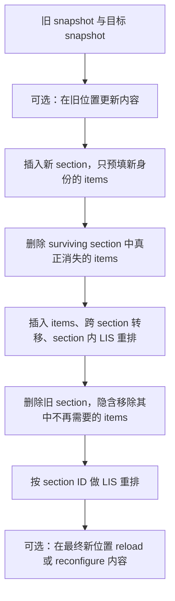

# Parade UI diff：第二轮

日期：2026-09-17。承接第一轮实验，按本轮提供材料最后选出的四项推进：section/item 联合变化、move + update staging、系统化 permutation、diff 与 reload 的交叉点。代码、报告和图表归档在本目录，原始数据与构建输出不提交；这里不是 Parade 的生产 API。

第一轮源码与结果保留原样。本轮复用未修改的 `../Sources/Core.swift`、固定版本 DifferenceKit checkout，使用独立执行文件、app ID 和结果目录。

## 本轮接受与保留的边界

- 底层 section ID 各自唯一、展示 item ID 全局唯一且稳定。组合 `(sectionID, itemID)` 可以表达局部唯一，但变更 section 前缀就是变更展示身份；需要测试真正跨 section move 时，ID 保持不变。
- 不再追逐 CPU 微小常数差异；仍记录完整 prepare 成本，避免只优化输出操作而忽略新增计划成本。不能泛化成“0.3 ms 在任何产品里都不重要”。
- `structure → reconfigure` 是被测方案。加入 `before → reload` 与 `structure → reload` 两个对照，区分执行顺序和更新原语的作用。
- `reload` 是性能对照，不是已批准的自动降级策略。其选择可能改变 selection、第一响应者、局部状态和可见位置；本轮没有验证这些完整交互合同。
- `contentVersion`、复杂 equality、allocation/peak memory、真机动画 hitch、sizing cache 和连续提交保持在后续研究范围。基准模型用 revision 不等于生产模型必须采用 revision。
- 第一轮 CPU 实际已经覆盖 Int 和带 section 前缀的 String；本轮 UIKit 继续使用 String，避免同时更换输入成本模型。

## 实验性 section planner

它按 section 的稳定身份判断 item 归属，不根据 section 的位置编号判断跨 section move。同一 section 的 item 相对顺序用 LIS；section 自身的重排另用 LIS。



没有变化的阶段被省略。执行器在 `performBatchUpdates` 内同步切换数据源，等待该 stage 的 completion 后才开始下一 stage。

这个顺序让幸存 item 可以先离开待删除容器，也可以进入已经建立的新容器。新 section 自带的新 item、删除 section 自带的消失 item 不额外生成逐项 insert/delete。已有身份始终只出现在一个 section，中间状态也必须全局唯一。

本轮保留真正跨 section item 的显式移动。DifferenceKit 在部分 section 新增/删除组合中使用容器删除/插入及 item 重建；这是操作语义差异，不自动等于错误。全部 section 被替换而 item ID 都保留时，自研计划可能产生大量跨 section move，反而比直接重建容器更贵。

**不声称联合全局最优。** 单序列的 `n - LIS` 只证明固定身份/单位单 item move 模型的最少移动数。section、item、容器隐含更新、阶段数与 UIKit 成本混在一起后，分别做两次 LIS 不等于全局最小总成本。本轮实现优先可验证的中间状态，也没有做 phase 融合或重用索引等 CPU 优化。

## 数据与正确性检查

### Section / item 矩阵

20 种组合，分别使用每节 2、20、1,000 个 item（共 3 节）。包括纯 section 左/右旋、section move + 本地 reorder、section move + 跨 section move、这些变化与 content update 叠加、从待删除 section 移出、移入刚插入 section、旧容器到新容器、三节循环转移、整节增删以及全部 section 替换。

明确断言：纯 section 旋转是 1 section move + 0 item move；整节插入/删除不会附加逐项 insert/delete。

### 独立 section replay

先重放 section 索引变化，再根据旧 item 坐标和新目标坐标重建每节数据，处理 inserted/deleted section 隐含的 item 变化。没有显式 update 的旧 item 保留旧 revision；因此漏报内容更新不能靠直接读取保存的目标值蒙混过关。

穷举两节、三个可选 item 的 98 种状态之间全部 9,604 个转换，另有 2,000 个带 section 增删、跨节重排与内容变化的固定种子随机转换，以及 60 个矩阵 fixture。分别验证 LIS-before、LIS-after、DifferenceKit，共 **34,992 份完整分阶段计划**。

UIKit 额外运行 200 个随机转换 × 5 个后端，检查实际 batch 合法性。计时矩阵每个样本验证 section/item 数、可见 cell 身份和 revision；计时结束后还滚动到各节首尾核对离开初始视口的结果。原生 diffable 另核对完整 snapshot。通过不等于所有离屏位置、动画中间帧或交互状态得到全面验证。

### Permutation

包含 rotate-k（1、2、10、n/2、n-1）、block move、block swap、interleave、odd-even、middle-to-head、多组不相交 block swap、reverse。

纯输出比较使用 64、1,000、10,000 项。独立 Fenwick-tree LIS 长度算法给出最少 move 数，并在 64 项上与 O(nm) LCS 动态规划交叉验证；被测 planner 使用二分 tails 与前驱回溯，避免同一实现既当被测对象又当 oracle。LIS 与标准库要求达到下界，Heckel 只要求正确并报告超额操作。10,000 项标准库未纳入本轮大排列预算，不补造数据。共 **132 组操作数量比较**。

UIKit 对 1,000 / 10,000 项测 Apple、DifferenceKit、LIS-after-reconfigure 三种完整后端。

### Churn 与 reload

100 / 1,000 / 10,000 项；0 / 10 / 25 / 50 / 75 / 90 / 100% item 被选中参与重排；每档 3 个固定种子。**被选中比例不是最少 move 比例，也不等于位置变化比例**。原始结果同时保存三者。

六个对照：

| 后端 | 做什么 | 能回答什么 |
|---|---|---|
| Apple-diff-reconfigure | 建 snapshot 后普通无动画 apply | 原生精确更新整体成本 |
| DifferenceKit-staged | 公共 sectioned changeset + 等待每阶段完成 | 成熟 staged 更新基线 |
| LIS-after-reconfigure | 自研 sectioned planner + 精确更新 | 自研完整后端成本 |
| UIKit-reloadData | 直接替换 model、reloadData、layout | 已决定重载时的成本下界对照 |
| Apple-reloadData | 建 snapshot 后 applySnapshotUsingReloadData | 原生显式重载成本 |
| LIS-then-reloadData | 完整计算 LIS 计划后丢弃，执行 reloadData | 如果阈值需要先算 diff，不能把决策成本免费抹去 |

0% 是无变化对照。`LIS-then-reloadData` 不是自动阈值策略，始终 reload；记录的 plan 操作没有被执行。也没有假装预先知道随机生成器的变更比例是生产调用方能免费提供的信息。

## 计时条件

宿主 Apple M4 Max / macOS 27.0 (26A428)，Xcode 27.0 (27A266a)，Apple Swift 6.4；所有本地代码同编译为 `-O -whole-module-optimization -swift-version 5`。iPhone 18 Pro / iOS 27.0 模拟器；arm64，最低目标 iOS 17。模拟器二进制的 Mach-O 平台为 IOSSIMULATOR。

固定 320×36 pt cell 与 flow layout，关闭 prefetch 和动画。每个正式组合 3 次预热、12 次样本，后端按固定种子在每轮打乱并串行运行；每个样本重新建立附着到 window 的 collection，初始状态构建不计时。按 prepare、apply、layout、total 分段记录。统计检查、滚动检查和文件写入在计时外。

UIKit reloadData 没有 completion，记录方法返回再完成 layout；其他路径等待公开 completion 后 layout。两者都是 CPU/布局完成边界，**都不代表像素已经显示**。动画、render-server 工作与 hitch 未被这些数值覆盖。

三个独立 shuffle 种子是 workload 变化，不是三次独立设备/进程环境复现实验。小差异不做稳定排名，12 次样本的 p95 只做描述性记录。其他用户进程、已启动模拟器和温度未被完全控制。

## 复现

先按[第一轮说明](../README.md)准备固定版本的 DifferenceKit；本轮沿用 `DIFFERENCEKIT_PATH`，默认读取 `../.build/DifferenceKit/Sources`。生成图表还需要 Python 的 `matplotlib`（可在虚拟环境中执行 `python3 -m pip install matplotlib`）。以下命令从仓库根目录执行。

```sh
python3 Benchmarks/DiffBenchmark/round2/build.py verify
Benchmarks/DiffBenchmark/round2/build/verify Benchmarks/DiffBenchmark/round2/results
python3 Benchmarks/DiffBenchmark/round2/build.py ui
```

安装 `build/ParadeDiffRound2.app`，bundle ID 为 `dev.weixi.ParadeDiffRound2`。选择当前实际存在的模拟器并等待 boot 完成，分别运行：

```text
--suite random --exit-when-done
--suite matrix --exit-when-done
--suite permutation --exit-when-done
--suite churn --exit-when-done
```

运行完成后执行 `python3 Benchmarks/DiffBenchmark/round2/report.py` 复算结果、生成 CSV 和 `assets/churn.png`；脚本需要下述四组 JSON 及 verify 生成的 `verification.json`。

结果写入 app Documents 的 `round2-<suite>.json`，期间 checkpoint 的 `complete` 为 false，只有最终结果为 true 才算完成。复制到本目录 `results/` 后运行 `report.py`。日志留有 fixture 与首次后端顺序，便于定位 invalid update。已有模拟器保留；实验 app 正常保存后退出。

## 资料

- [Apple reconfigureItems(at:)](https://developer.apple.com/documentation/uikit/uicollectionview/reconfigureitems(at:))：重配现有 cell；custom data source 可用，自适应尺寸仍可能引发布局工作。
- [Apple performBatchUpdates](https://developer.apple.com/documentation/uikit/uicollectionview/performbatchupdates(_:completion:))：数据源与批次同步切换。
- [第一轮实验](../README.md)及固定版本/许可说明。DifferenceKit 仍为 `02ca1968b10305d4d6771f4005a7ce2c507a8539`，没有修改其源码。

研究产物不自动引入 production contentVersion 协议、sizing cache、取消/合并队列或 fallback 阈值。
