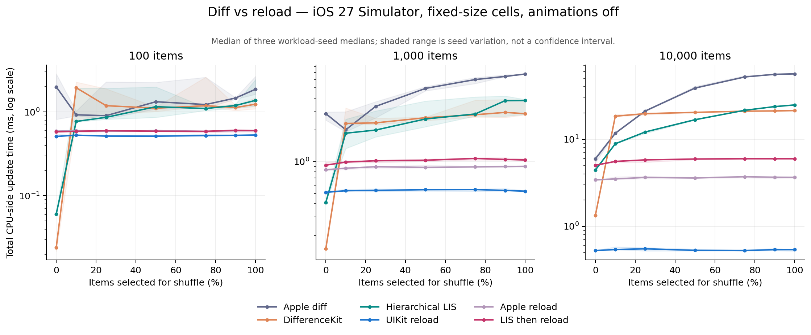

# Parade UI diff 第二轮结果

**四项实验都已完成。LIS 的最少移动性质保留到了 section 内部，但没有自动变成最快的完整后端；高变更量时，reload 的收益远大于继续压低 move 数。**

详细输入、planner 阶段、复现命令及验证限制见 [实验说明](README.md)。第一轮源码和结果保持原样。

## Section 与 item 联合变化

下面是 3 节 × 每节 1,000 项。S 表示显式 section move，I 表示显式 item move。下表来自计划的独立重放，不是从耗时反推操作数。

| 场景 | DifferenceKit | 分层 LIS |
|---|---:|---:|
| section-rotate-left | 2 S + 0 I + 0 update | 1 S + 0 I + 0 update |
| section-rotate-right | 1 S + 0 I + 0 update | 1 S + 0 I + 0 update |
| section-move-and-local-reorder | 1 S + 999 I + 0 update | 1 S + 1 I + 0 update |
| section-move-cross-section-move-update | 1 S + 1000 I + 1 update | 1 S + 1 I + 1 update |

整个 section 移动不会制造 item move；这一点 DifferenceKit 同样满足。区别出现在 section 或 section 内 item 的重排选择。

**容器替换暴露了另一种取舍。** 从待删除 section 逃出的幸存 item，自研 planner 先转移再删容器；移入新 section 时先建容器再转移。两种 staging 在 UIKit 中通过了检查。
但是替换全部 section、仍保留 3,000 个 item ID 时，自研 planner 为维持显式移动产生 3,000 次跨 section move；DifferenceKit 通过旧容器删除与新容器插入完成重建，不产生显式 item move。
该样本的完整更新中位数：DifferenceKit **1.780 ms**，LIS-after-reconfigure **8.200 ms**。操作语义不同，不能只数显式操作就宣布谁更优；交互状态连续性仍未全面验证。

## Move + update：三种 staging 均通过本轮用例，尚无统一性能赢家

单位 ms，完整更新中位数，3,000 项。before/after 对照执行顺序，after-reload/after-reconfigure 对照更新原语。

| 场景 | 更新后移动 / reload | 移动后 reload | 移动后 reconfigure | DifferenceKit | Apple |
|---|---:|---:|---:|---:|---:|
| move-and-update | 3.977 | 3.625 | 2.716 | 1.539 | 2.256 |
| cross-section-move-update | 2.707 | 2.718 | 2.565 | 2.436 | 3.458 |
| section-move-and-item-update | 3.165 | 3.310 | 3.241 | 2.915 | 7.354 |
| enter-inserted-section-update | 2.877 | 2.909 | 2.869 | 1.637 | 3.197 |
| deleted-to-inserted-section-update | 3.488 | 3.516 | 3.478 | 3.074 | 2.678 |

例如 move-and-update 中，LIS-before 只配置 1 个 cell，两个 LIS-after 变体配置 2 个：旧位置离屏、移动后进入视口，会改变“在哪一阶段更新”所触发的工作。reconfigure 保留现有 cell 的能力值得用，但不能从名称推导每种场景都更快。
小差距不做稳定排名。这里关闭动画，只验证最终内容；不同阶段间旧内容是否可见、是否闪烁、第一响应者等仍没有验证。

## 系统化 permutation 与数学下界

10,000 项；下界为 `n − LIS`，由独立 Fenwick-tree 实现计算，小样本再与动态规划 LCS 交叉验证。

| 排列 | 最少 move | DifferenceKit / 自研 Heckel | Key + LIS |
|---|---:|---:|---:|
| rotate-1 | 1 | 9999 / 9999 | 1 |
| rotate-2 | 2 | 9998 / 9998 | 2 |
| rotate-10 | 10 | 9990 / 9990 | 10 |
| rotate-5000 | 5000 | 5000 / 5000 | 5000 |
| rotate-9999 | 1 | 1 / 1 | 1 |
| block-move | 2500 | 2500 / 2500 | 2500 |
| block-swap | 5000 | 7500 / 7500 | 5000 |
| interleave | 4999 | 4999 / 4999 | 4999 |
| odd-even | 5000 | 5000 / 5000 | 5000 |
| middle-to-head | 1 | 1 / 1 | 1 |
| disjoint-block-swaps | 5000 | 5000 / 5000 | 5000 |
| reverse | 9999 | 9999 / 9999 | 9999 |

**最少 move 没有直接保证最短总耗时。** 本轮通用 section planner 重建了多份身份映射和阶段数据，尚未优化：

| 10,000 项 | DifferenceKit 总耗时 | LIS 总耗时 | LIS prepare | Apple 总耗时 |
|---|---:|---:|---:|---:|
| rotate-1 | 15.536 | 6.860 | 4.744 | 6.046 |
| rotate-10 | 15.686 | 6.730 | 4.743 | 6.203 |
| block-swap | 13.040 | 14.375 | 5.205 | 29.238 |
| reverse | 17.368 | 20.962 | 5.141 | 43.068 |

block-swap 的 LIS move 从 7,500 降到 5,000，但额外准备成本抵消了应用收益。第一轮平面 LIS 的数字不能拿来替代这一版 section planner 的成本；“CPU 暂时不卷”可以是本轮工作优先级，不能变成永远忽略 prepare 的结论。

## Diff 与 reload：交叉点已经落在最初的采样区间

纵轴为对数坐标，单位 ms。每条线是三个 workload seed 各自中位数再取中位数；阴影是 seed 之间的范围，不是置信区间。横轴是选中参与 shuffle 的比例，不是实际 move 比例。

10,000 项的汇总：

| 选中重排比例 | 实际最少 move 比例范围 | Apple diff | DifferenceKit | LIS 精确更新 | 直接 reloadData | Apple 显式 reload | 先算 LIS 再 reload |
|---|---:|---:|---:|---:|---:|---:|---:|
| 0% | 0.00–0.00% | 5.941 | 1.331 | 4.426 | 0.525 | 3.405 | 5.019 |
| 10% | 9.99–9.99% | 11.702 | 18.375 | 8.857 | 0.539 | 3.498 | 5.554 |
| 25% | 24.95–24.98% | 21.073 | 19.669 | 12.110 | 0.550 | 3.637 | 5.787 |
| 50% | 49.95–49.97% | 38.695 | 20.346 | 16.742 | 0.528 | 3.585 | 5.919 |
| 75% | 74.91–74.97% | 51.939 | 21.008 | 21.499 | 0.525 | 3.706 | 5.962 |
| 90% | 89.82–89.85% | 55.676 | 21.133 | 23.698 | 0.538 | 3.654 | 5.960 |
| 100% | 98.01–98.08% | 56.286 | 21.314 | 24.743 | 0.539 | 3.641 | 5.962 |

**扣除“免费知道是否该 reload”的假设后，收益仍存在。** `LIS-then-reloadData` 先完整生成计划，再把计划丢弃后 reload；其 prepare 成本包含在表内。

| 项数 | 0% 时：LIS / 先算再 reload | 10% 时：LIS / 先算再 reload | 首次观察到的交叉区间 |
|---|---:|---:|---|
| 100 | 0.061 / 0.581 | 0.771 / 0.588 | 0% 与 10% 选中重排之间 |
| 1,000 | 0.412 / 0.927 | 1.861 / 0.992 | 0% 与 10% 选中重排之间 |
| 10,000 | 4.426 / 5.019 | 8.857 / 5.554 | 0% 与 10% 选中重排之间 |

这是离散采样的区间，不是测出了精确阈值，更不是建议在生产里设 10%。简单固定尺寸 cell、关闭动画、有限可见窗口，都有利于 reload；它不保持哪些交互状态、真实尺寸重测代价多大，本轮尚未回答。100 / 1,000 / 10,000 项完整数据都在 CSV/JSON 中。
当前数据已经足以说明：应将精确更新与重载看成需要产品语义约束的两种执行策略。是否允许重载、是否保留 anchor/selection/first responder，应先成为明确合同，再用真机与真实 cell 成本定阈值。

## 验证范围与产物

- 34,992 份 section 计划的独立逐阶段重放；98 个微型状态的全部 9,604 个转换，另有 2,000 个随机转换。
- 132 组 permutation 操作数量比较，LIS 在这些样本中达到独立 oracle 下界。
- 300 组 UIKit 组合矩阵、72 组 UIKit permutation、378 组 diff/reload 对照；每组 3 次预热与 12 次正式样本，共 9,000 次计时更新。
- 额外 200 个随机 fixture × 5 个 backend，共 1,000 次 UIKit 功能验证。所有结果文件 complete=true；未观察到 invalid update 或内容核对失败。
- 模拟器 iPhone 18 Pro / iOS 27.0，宿主 Apple M4 Max；这不是 CPU/图形/内存/帧时的真机性能结论，也未证明动画连续性。

[实验代码与方法](README.md) · 组合矩阵 CSV（`results/matrix.csv`，本地生成） · Permutation CSV（`results/permutation.csv`，本地生成） · Churn CSV（`results/churn.csv`，本地生成） · 独立验证结果（`results/verification.json`，本地生成） · 曲线 SVG（`results/churn.svg`，本地生成）

原始 JSON、每个样本的 prepare/apply/layout/total、各阶段操作数量和执行日志均保存在 results/。
