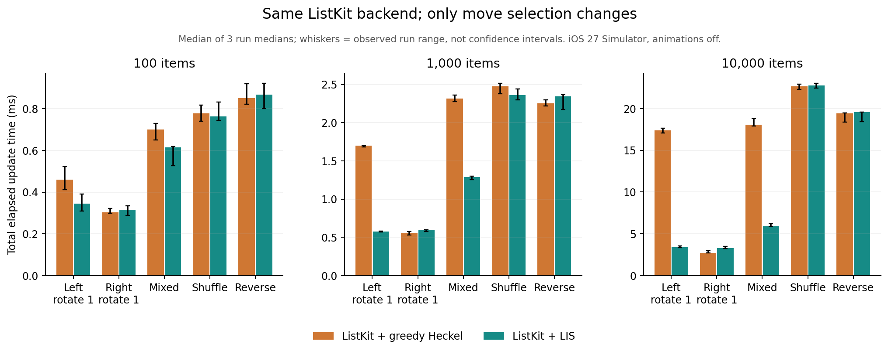

# 第三轮完整结果：ListKit、Heckel、LIS 与 UIKit

**后续诊断修正：本轮采用新建列表后立即更新的采样方式。统一提交初始事务并在计时外等待 30 ms 后，100 项追加 / 右旋中 ListKit 的明显优势消失。以下保留原始结果，不应直接用作稳定展示中的列表性能排名。空 UIKit 调用也未被补测确认为主要差额来源。见 [追查结果](diagnostics/RESULTS.md)。**

**完整性能矩阵已串行跑完三轮。结论是有条件的：LIS 不保证完整后端更快，但当它把数百 / 数千个多余 move 压到很少时，收益能直接体现在实际 UIKit 更新总耗时。**

本轮不复用旧轮耗时；所有表来自同一个新 harness 的重新测量。[方法、版本与复现](README.md)。

- 平面 / 排列 / churn / 多节：每轮共 1,543 个组合，三轮共 4,629 行结果、147,510 次正式更新，另有 23,145 次预热。
- 14,828 次 matcher 检查；200 组随机多节 × 5 个后端，共 1,000 次额外 UIKit 检查。全部 complete=true。
- Apple M4 Max；iPhone 18 Pro / iOS 27.0 模拟器；Xcode 27 / Swift 6.4；-O + whole-module-optimization。

**单位统一为 ms。** 主表是三轮各自中位数的中位数；不是最快值。总耗时包括准备、内部 diff / 任务等待、UIKit 更新到 completion 或直接调用返回，再完成 layout。未测像素呈现或动画帧时间。

## 1. 首先看常见边界：100 项

以下均为精确更新路径。ListKit 两列只有 move 选择不同。Apple 分开 reloadItems 与 reconfigure；自研 / DifferenceKit 的内容使用 reload，因此 update / mixed 跨列差异不能只归因于 LIS。

| 场景 | Apple reloadItems | Apple reconfigure | DifferenceKit | 自研 Heckel | 自研 LIS | ListKit LIS | ListKit Heckel |
|---|---:|---:|---:|---:|---:|---:|---:|
| 无变化 | 0.508 | 0.598 | 0.026 | 0.019 | 0.018 | 0.034 | 0.037 |
| 尾部新增 5% | 0.557 | 0.556 | 0.500 | 0.480 | 0.503 | 0.260 | 0.267 |
| 头部新增 5% | 0.688 | 0.726 | 0.609 | 0.599 | 0.626 | 0.383 | 0.388 |
| 删除 5% | 0.620 | 0.623 | 0.531 | 0.556 | 0.535 | 0.331 | 0.328 |
| 内容更新 5% | 0.728 | 0.695 | 0.545 | 0.530 | 0.552 | 0.221 | 0.239 |
| 相邻交换 | 0.563 | 0.542 | 0.480 | 0.468 | 0.485 | 0.243 | 0.248 |
| 左旋一项 | 0.641 | 0.682 | 0.699 | 0.680 | 0.594 | 0.346 | 0.459 |
| 右旋一项 | 0.618 | 0.592 | 0.522 | 0.531 | 0.545 | 0.316 | 0.303 |
| 混合更新 | 0.977 | 1.008 | 1.216 | 1.277 | 1.160 | 0.614 | 0.701 |
| 随机乱序 | 1.343 | 1.357 | 1.050 | 0.961 | 0.987 | 0.763 | 0.778 |
| 完全逆序 | 1.510 | 1.461 | 1.152 | 1.103 | 1.079 | 0.867 | 0.851 |
| 全部替换 | 1.256 | 1.268 | 1.081 | 1.057 | 1.083 | 0.790 | 0.786 |

100 项时的阶段与内容更新对照：

| 场景 | 自研 Heckel batch / cell 配置 | DifferenceKit batch / cell 配置 | ListKit Heckel batch / cell 配置 | ListKit LIS batch / cell 配置 |
|---|---:|---:|---:|---:|
| 头部新增 5% | 1 / 5 | 1 / 5 | 1 / 5 | 1 / 5 |
| 内容更新 5% | 1 / 2 | 1 / 2 | 0 / 2 | 0 / 2 |
| 混合更新 | 3 / 9 | 3 / 9 | 1 / 8 | 1 / 8 |

这里应优先看无变化、追加 / 前插、内容更新与 mixed 的绝对时间；不能把 10,000 项旋转的倍数直接用作日常需求的架构权重。

ListKit 两种算法在无变化和纯内容更新时走相同快速路径；跨框架的源码差异还包括 snapshot 表示、空操作省略、阶段数和 reconfigure 的执行方式。各项差异不等于已经测出了各自的收益，后续诊断也未发现空调用是主要差额来源。

本轮自研 / DifferenceKit 的 UIKit 适配器沿用逐 stage 的执行方式，并仍会调用空数组的 UIKit 方法；ListKit 原版会跳过这些调用。两者的完整后端差距不是“自研 Heckel 的性能上限”。阶段数、内容原语、空调用的各自贡献没有单独分摊，本轮最干净的算法因果对照仍是 ListKit 内部两个版本。

## 2. 同一个 ListKit：LIS 是否仅让结果漂亮？

| 项数 / 场景 | Heckel move | LIS move | Heckel 总耗时 | LIS 总耗时 | LIS 节省 ms | Heckel / LIS |
|---|---:|---:|---:|---:|---:|---:|
| 100 / 左旋一项 | 99 | 1 | 0.459 | 0.346 | +0.113 | 1.33× |
| 100 / 右旋一项 | 1 | 1 | 0.303 | 0.316 | -0.014 | 0.96× |
| 100 / 混合更新 | 90 | 5 | 0.701 | 0.614 | +0.087 | 1.14× |
| 100 / 随机乱序 | 96 | 85 | 0.778 | 0.763 | +0.015 | 1.02× |
| 100 / 完全逆序 | 99 | 99 | 0.851 | 0.867 | -0.015 | 0.98× |
| 1,000 / 左旋一项 | 999 | 1 | 1.698 | 0.576 | +1.122 | 2.95× |
| 1,000 / 右旋一项 | 1 | 1 | 0.559 | 0.600 | -0.041 | 0.93× |
| 1,000 / 混合更新 | 900 | 50 | 2.314 | 1.287 | +1.027 | 1.80× |
| 1,000 / 随机乱序 | 996 | 941 | 2.474 | 2.359 | +0.114 | 1.05× |
| 1,000 / 完全逆序 | 999 | 999 | 2.253 | 2.342 | -0.089 | 0.96× |
| 10,000 / 左旋一项 | 9,999 | 1 | 17.361 | 3.370 | +13.991 | 5.15× |
| 10,000 / 右旋一项 | 1 | 1 | 2.734 | 3.304 | -0.570 | 0.83× |
| 10,000 / 混合更新 | 9,000 | 500 | 18.085 | 5.878 | +12.207 | 3.08× |
| 10,000 / 随机乱序 | 9,994 | 9,815 | 22.678 | 22.783 | -0.105 | 1.00× |
| 10,000 / 完全逆序 | 9,999 | 9,999 | 19.419 | 19.581 | -0.162 | 0.99× |

读法：节省为正表示 LIS 更快；倍数是 Heckel 耗时除以 LIS 耗时。旋转和 mixed 可大幅减少操作；shuffle 往往只能少一小部分；reverse 两边仍然都需要 n−1 个 move。

**三种情况必须分开：**

1. 少报大量 move：额外 LIS 计算可能被 UIKit 侧节省覆盖，左旋是明确检验点。
2. 只少报少量 move：总耗时可能接近，shuffle 应结合三轮波动阅读。
3. move 完全相同：LIS 不提供操作数量收益，有时额外计算反而更贵，例如右旋一项。

更准确的成本模型是 `总时间 = 内容/snapshot准备 + 匹配与move选择 + 调度等待 + UIKit批次工作 + 最终layout`。LIS 最小化单位 item move 的数量，并未最小化这整个式子。不同 move 涉及的可见 cell、更新内容、section 与布局范围也不同，不能给每个 move 统一标一个恒定价格。

因此，即使同样少了 25 次 move，在 100 项、复杂 self-sizing cell、或者全部离屏的情况下，收益也可能不同。本轮使用简单固定高度 cell；真实内容和提交频率需要单独赋予权重，绝对差 0.1 ms 也不能无条件当成零。

三轮重复的范围如下，避免把很小的差值当稳定结论：

| 项数 / 场景 | Heckel 各轮中位数范围 | LIS 各轮中位数范围 |
|---|---:|---:|
| 100 / 左旋一项 | 0.411–0.522 | 0.310–0.391 |
| 100 / 右旋一项 | 0.298–0.322 | 0.289–0.333 |
| 100 / 随机乱序 | 0.740–0.817 | 0.745–0.831 |
| 1,000 / 左旋一项 | 1.683–1.703 | 0.570–0.581 |
| 1,000 / 右旋一项 | 0.529–0.577 | 0.573–0.600 |
| 1,000 / 随机乱序 | 2.378–2.518 | 2.297–2.441 |
| 10,000 / 左旋一项 | 17.078–17.629 | 3.358–3.549 |
| 10,000 / 右旋一项 | 2.709–2.987 | 3.242–3.510 |
| 10,000 / 随机乱序 | 22.301–22.931 | 22.425–23.039 |

## 3. 完整平面大规模数据

### 1,000 项

| 场景 | Apple reloadItems | Apple reconfigure | DifferenceKit | 自研 Heckel | 自研 LIS | ListKit LIS | ListKit Heckel |
|---|---:|---:|---:|---:|---:|---:|---:|
| 无变化 | 1.012 | 0.881 | 0.149 | 0.141 | 0.139 | 0.157 | 0.158 |
| 尾部新增 5% | 1.122 | 1.150 | 0.658 | 0.678 | 0.686 | 0.554 | 0.541 |
| 头部新增 5% | 1.584 | 1.638 | 1.090 | 1.094 | 1.055 | 1.037 | 0.984 |
| 删除 5% | 1.302 | 1.306 | 0.872 | 0.902 | 0.866 | 0.787 | 0.712 |
| 内容更新 5% | 1.154 | 1.111 | 0.696 | 0.719 | 0.743 | 0.420 | 0.415 |
| 相邻交换 | 0.992 | 1.018 | 0.616 | 0.607 | 0.600 | 0.508 | 0.469 |
| 左旋一项 | 1.114 | 1.032 | 1.825 | 1.758 | 0.671 | 0.576 | 1.698 |
| 右旋一项 | 1.138 | 1.131 | 0.691 | 0.673 | 0.708 | 0.600 | 0.559 |
| 混合更新 | 2.149 | 2.068 | 2.662 | 2.675 | 1.770 | 1.287 | 2.314 |
| 随机乱序 | 6.464 | 6.058 | 2.587 | 2.578 | 2.481 | 2.359 | 2.474 |
| 完全逆序 | 6.291 | 6.081 | 2.337 | 2.237 | 2.338 | 2.342 | 2.253 |
| 全部替换 | 5.096 | 4.728 | 2.535 | 2.524 | 2.537 | 2.342 | 2.393 |

### 10,000 项

| 场景 | Apple reloadItems | Apple reconfigure | DifferenceKit | 自研 Heckel | 自研 LIS | ListKit LIS | ListKit Heckel |
|---|---:|---:|---:|---:|---:|---:|---:|
| 无变化 | 5.546 | 5.419 | 1.380 | 1.437 | 1.433 | 1.317 | 1.345 |
| 尾部新增 5% | 6.888 | 6.861 | 2.405 | 2.586 | 2.507 | 3.659 | 3.041 |
| 头部新增 5% | 7.749 | 7.724 | 3.038 | 3.061 | 3.133 | 4.337 | 3.891 |
| 删除 5% | 7.165 | 7.212 | 2.765 | 3.203 | 3.243 | 3.879 | 3.331 |
| 内容更新 5% | 6.394 | 5.995 | 2.652 | 2.810 | 2.796 | 2.325 | 2.344 |
| 相邻交换 | 6.102 | 6.041 | 2.110 | 2.191 | 2.421 | 3.225 | 2.782 |
| 左旋一项 | 6.316 | 6.294 | 15.569 | 15.598 | 2.620 | 3.370 | 17.361 |
| 右旋一项 | 6.258 | 6.170 | 2.236 | 2.255 | 2.631 | 3.304 | 2.734 |
| 混合更新 | 11.277 | 11.012 | 16.431 | 17.217 | 6.847 | 5.878 | 18.085 |
| 随机乱序 | 56.769 | 56.871 | 20.817 | 21.055 | 20.985 | 22.783 | 22.678 |
| 完全逆序 | 44.910 | 45.106 | 17.705 | 17.615 | 17.662 | 19.581 | 19.419 |
| 全部替换 | 34.351 | 34.485 | 16.999 | 17.594 | 17.627 | 17.982 | 17.741 |

**跨后端排名不是算法排名。** 例如自研平面原型比 ListKit 少了通用 snapshot / 调度能力；ListKit 两种版本都保留 1,000 项起的后台 diff。相同 move 数下仍会出现存储、适配、调度和执行器成本差异。

## 4. Systematic permutation：所有排列都跑了

rotate-k 表示左旋 k 项，rotate-(n−1) 等价于右旋一项。每表保留原始场景名称，便于定位 CSV。

### 100 项

| 场景 | Apple reconfigure | DifferenceKit | 自研 Heckel | 自研 LIS | ListKit LIS | ListKit Heckel |
|---|---:|---:|---:|---:|---:|---:|
| rotate-1 | 0.573 | 0.652 | 0.671 | 0.543 | 0.305 | 0.430 |
| rotate-2 | 0.646 | 0.763 | 0.674 | 0.595 | 0.342 | 0.501 |
| rotate-10 | 0.788 | 0.814 | 0.782 | 0.667 | 0.493 | 0.555 |
| rotate-50 | 1.198 | 1.021 | 0.952 | 0.958 | 0.770 | 0.758 |
| rotate-99 | 0.576 | 0.525 | 0.511 | 0.510 | 0.297 | 0.303 |
| block-move | 1.052 | 0.945 | 0.946 | 0.939 | 0.719 | 0.740 |
| block-swap | 1.261 | 1.015 | 0.984 | 0.977 | 0.788 | 0.777 |
| interleave | 1.001 | 0.779 | 0.772 | 0.810 | 0.558 | 0.557 |
| odd-even | 1.003 | 0.805 | 0.791 | 0.785 | 0.581 | 0.555 |
| middle-to-head | 0.637 | 0.584 | 0.595 | 0.580 | 0.334 | 0.346 |
| disjoint-block-swaps | 0.797 | 0.589 | 0.643 | 0.640 | 0.361 | 0.362 |
| 完全逆序 | 1.345 | 1.053 | 1.079 | 0.989 | 0.838 | 0.811 |

### 1,000 项

| 场景 | Apple reconfigure | DifferenceKit | 自研 Heckel | 自研 LIS | ListKit LIS | ListKit Heckel |
|---|---:|---:|---:|---:|---:|---:|
| rotate-1 | 1.018 | 1.817 | 1.828 | 0.655 | 0.527 | 1.703 |
| rotate-2 | 1.029 | 1.815 | 1.808 | 0.728 | 0.568 | 1.768 |
| rotate-10 | 1.187 | 1.974 | 2.067 | 0.837 | 0.703 | 1.837 |
| rotate-500 | 3.317 | 1.745 | 1.684 | 1.857 | 1.631 | 1.575 |
| rotate-999 | 1.011 | 0.722 | 0.724 | 0.739 | 0.556 | 0.522 |
| block-move | 2.333 | 1.346 | 1.336 | 1.344 | 1.271 | 1.171 |
| block-swap | 3.922 | 1.951 | 1.902 | 1.643 | 1.550 | 1.869 |
| interleave | 3.336 | 1.554 | 1.550 | 1.578 | 1.461 | 1.444 |
| odd-even | 3.382 | 1.451 | 1.440 | 1.533 | 1.393 | 1.346 |
| middle-to-head | 1.095 | 0.655 | 0.615 | 0.657 | 0.510 | 0.471 |
| disjoint-block-swaps | 3.222 | 1.697 | 1.616 | 1.643 | 1.552 | 1.466 |
| 完全逆序 | 5.966 | 2.457 | 2.251 | 2.441 | 2.230 | 2.229 |

### 10,000 项

| 场景 | Apple reconfigure | DifferenceKit | 自研 Heckel | 自研 LIS | ListKit LIS | ListKit Heckel |
|---|---:|---:|---:|---:|---:|---:|
| rotate-1 | 5.854 | 15.162 | 15.233 | 2.137 | 2.737 | 16.555 |
| rotate-2 | 5.949 | 15.435 | 15.335 | 2.231 | 2.698 | 16.497 |
| rotate-10 | 6.140 | 15.330 | 15.181 | 2.395 | 2.928 | 16.454 |
| rotate-5000 | 24.548 | 9.573 | 9.543 | 9.666 | 10.906 | 10.225 |
| rotate-9999 | 5.725 | 1.918 | 1.749 | 2.012 | 2.684 | 2.099 |
| block-move | 15.096 | 5.948 | 5.498 | 5.936 | 6.218 | 6.418 |
| block-swap | 29.128 | 12.931 | 12.785 | 10.434 | 11.454 | 13.774 |
| interleave | 32.166 | 9.676 | 9.658 | 9.687 | 10.827 | 10.482 |
| odd-even | 31.871 | 9.271 | 9.379 | 9.514 | 10.521 | 10.011 |
| middle-to-head | 5.969 | 2.035 | 1.862 | 2.248 | 2.848 | 2.252 |
| disjoint-block-swaps | 25.578 | 9.653 | 9.664 | 9.830 | 10.928 | 10.555 |
| 完全逆序 | 42.322 | 16.955 | 16.863 | 16.911 | 18.177 | 18.076 |

### 10,000 项实际提交的 move 数

| 场景 | DifferenceKit | 自研 Heckel | 自研 LIS | ListKit LIS | ListKit Heckel |
|---|---:|---:|---:|---:|---:|
| rotate-1 | 9999 | 9999 | 1 | 1 | 9999 |
| rotate-2 | 9998 | 9998 | 2 | 2 | 9998 |
| rotate-10 | 9990 | 9990 | 10 | 10 | 9990 |
| rotate-5000 | 5000 | 5000 | 5000 | 5000 | 5000 |
| rotate-9999 | 1 | 1 | 1 | 1 | 1 |
| block-move | 2500 | 2500 | 2500 | 2500 | 2500 |
| block-swap | 7500 | 7500 | 5000 | 5000 | 7500 |
| interleave | 4999 | 4999 | 4999 | 4999 | 4999 |
| odd-even | 5000 | 5000 | 5000 | 5000 | 5000 |
| middle-to-head | 1 | 1 | 1 | 1 | 1 |
| disjoint-block-swaps | 5000 | 5000 | 5000 | 5000 | 5000 |
| reverse | 9999 | 9999 | 9999 | 9999 | 9999 |

## 5. Churn 与 reload 对照

**ListKit 的 false 不等于 Apple 的 false。** 该版本 ListKit 在 diff 后只要有变化就 reloadData；下面才把它放在重载对照中。0% 无变化仍走快速返回。不能拿这一列冒充精确更新胜出。

每档值先按每个 seed 汇总三轮，再对三个 seed 取中位数。比例是被选中参与重排的 item 占比，不是最少 move 比例，也不是已测出的生产 fallback 阈值。

### 100 项

| 选中重排 | Apple reconfigure | DifferenceKit | 自研 Heckel | 自研 LIS | ListKit LIS | ListKit Heckel | ListKit false → reload | Apple reloadData | UIKit reloadData |
|---|---:|---:|---:|---:|---:|---:|---:|---:|---:|
| 0% | 0.696 | 0.022 | 0.016 | 0.016 | 0.035 | 0.037 | 0.036 | 0.603 | 0.541 |
| 10% | 0.662 | 0.657 | 0.670 | 0.594 | 0.353 | 0.411 | 0.594 | 0.590 | 0.526 |
| 25% | 0.903 | 0.791 | 0.810 | 0.665 | 0.407 | 0.497 | 0.621 | 0.600 | 0.530 |
| 50% | 0.951 | 0.812 | 0.844 | 0.757 | 0.493 | 0.546 | 0.622 | 0.584 | 0.522 |
| 75% | 1.179 | 0.943 | 0.959 | 0.888 | 0.661 | 0.664 | 0.653 | 0.595 | 0.535 |
| 90% | 1.331 | 1.001 | 0.961 | 0.952 | 0.683 | 0.722 | 0.632 | 0.599 | 0.524 |
| 100% | 1.344 | 0.995 | 1.044 | 0.989 | 0.708 | 0.739 | 0.607 | 0.596 | 0.519 |

### 1,000 项

| 选中重排 | Apple reconfigure | DifferenceKit | 自研 Heckel | 自研 LIS | ListKit LIS | ListKit Heckel | ListKit false → reload | Apple reloadData | UIKit reloadData |
|---|---:|---:|---:|---:|---:|---:|---:|---:|---:|
| 0% | 0.969 | 0.128 | 0.111 | 0.109 | 0.133 | 0.138 | 0.137 | 0.864 | 0.547 |
| 10% | 1.687 | 2.091 | 2.155 | 0.833 | 0.715 | 1.857 | 0.868 | 0.876 | 0.533 |
| 25% | 2.455 | 2.184 | 2.073 | 1.181 | 0.995 | 1.944 | 0.876 | 0.857 | 0.523 |
| 50% | 4.037 | 2.331 | 2.261 | 1.774 | 1.501 | 2.127 | 0.887 | 0.873 | 0.528 |
| 75% | 5.690 | 2.568 | 2.531 | 2.245 | 2.102 | 2.263 | 0.917 | 0.876 | 0.536 |
| 90% | 6.163 | 2.634 | 2.584 | 2.451 | 2.313 | 2.344 | 0.968 | 0.896 | 0.527 |
| 100% | 6.632 | 2.630 | 2.690 | 2.674 | 2.435 | 2.441 | 0.968 | 0.893 | 0.545 |

### 10,000 项

| 选中重排 | Apple reconfigure | DifferenceKit | 自研 Heckel | 自研 LIS | ListKit LIS | ListKit Heckel | ListKit false → reload | Apple reloadData | UIKit reloadData |
|---|---:|---:|---:|---:|---:|---:|---:|---:|---:|
| 0% | 5.289 | 1.191 | 1.088 | 1.069 | 0.995 | 0.997 | 0.983 | 3.430 | 0.557 |
| 10% | 11.430 | 17.768 | 17.797 | 4.879 | 4.690 | 19.100 | 3.050 | 3.565 | 0.560 |
| 25% | 20.389 | 18.613 | 18.569 | 7.900 | 8.096 | 19.567 | 3.214 | 3.552 | 0.553 |
| 50% | 37.576 | 19.628 | 19.581 | 12.652 | 13.708 | 21.023 | 3.522 | 3.589 | 0.550 |
| 75% | 51.282 | 20.474 | 20.391 | 17.207 | 18.451 | 21.560 | 3.554 | 3.686 | 0.557 |
| 90% | 54.791 | 20.525 | 20.468 | 19.417 | 20.637 | 21.642 | 3.572 | 3.629 | 0.551 |
| 100% | 56.933 | 20.930 | 20.749 | 20.989 | 22.343 | 22.159 | 3.627 | 3.716 | 0.562 |

### 局部重排也可能放大贪心 move 数

| 项数 / 被选中重排 | Heckel 实际 move 范围 | LIS 实际 move 范围 | Heckel 总耗时 | LIS 总耗时 |
|---|---:|---:|---:|---:|
| 100 / 10% | 57–67 | 7–10 | 0.411 | 0.353 |
| 100 / 50% | 88–94 | 44–47 | 0.546 | 0.493 |
| 100 / 100% | 93–95 | 80–84 | 0.739 | 0.708 |
| 1,000 / 10% | 980–986 | 99–100 | 1.857 | 0.715 |
| 1,000 / 50% | 985–993 | 493–499 | 2.127 | 1.501 |
| 1,000 / 100% | 992–994 | 941–944 | 2.441 | 2.435 |
| 10,000 / 10% | 9,974–9,984 | 999–999 | 19.100 | 4.690 |
| 10,000 / 50% | 9,983–9,988 | 4,995–4,997 | 21.023 | 13.708 |
| 10,000 / 100% | 9,988–9,993 | 9,801–9,808 | 22.159 | 22.343 |

贪心扫描以“下一个尚未消耗的旧位置”为保留基准；少数 item 提前 / 推后就可能让不少原本相对有序的 item 被显式移动。因此少量位置被选中参与 shuffle，并不保证 Heckel 只提交少量 move。是否属于业务常见输入应由真实更新模式判断，不能只用“整体没怎么变”代替测量。

ListKit false 列包含完整 diff 决策成本，UIKit reloadData 列不算 diff，也不建 ID snapshot。后者描述已决定重载时的成本。重载是否允许仍取决于状态保持与真实 cell 成本，本轮没有验证完整交互合同。

## 6. Section + item 联合变化

三节合计 6 / 99 / 999 / 9,999 项；20 场景 × 5 后端 × 3 轮全部通过。这里测公开 sectioned DifferenceKit 和 ListKit；自研平面原型不冒充多节实现。

### 合计 6 项

| 场景 | Apple reloadItems | Apple reconfigure | DifferenceKit | ListKit LIS | ListKit Heckel |
|---|---:|---:|---:|---:|---:|
| cross-section-move-update | 0.394 | 0.345 | 0.339 | 0.195 | 0.190 |
| deleted-to-inserted-section | 0.313 | 0.310 | 0.346 | 0.172 | 0.167 |
| deleted-to-inserted-section-update | 0.419 | 0.390 | 0.349 | 0.229 | 0.225 |
| enter-inserted-section | 0.381 | 0.377 | 0.419 | 0.242 | 0.239 |
| enter-inserted-section-update | 0.475 | 0.444 | 0.412 | 0.303 | 0.297 |
| escape-deleted-section | 0.278 | 0.275 | 0.325 | 0.163 | 0.164 |
| escape-deleted-section-update | 0.394 | 0.363 | 0.327 | 0.223 | 0.231 |
| move-and-update | 0.375 | 0.338 | 0.324 | 0.183 | 0.179 |
| replace-all-sections-new-identities | 0.411 | 0.418 | 0.384 | 0.251 | 0.247 |
| replace-all-sections-preserve-items | 0.302 | 0.312 | 0.391 | 0.237 | 0.237 |
| section-delete-without-item-deletes | 0.259 | 0.255 | 0.203 | 0.120 | 0.118 |
| section-insert-without-item-inserts | 0.370 | 0.360 | 0.298 | 0.212 | 0.209 |
| section-move-and-cross-section-move | 0.305 | 0.306 | 0.324 | 0.138 | 0.136 |
| section-move-and-item-update | 0.395 | 0.384 | 0.355 | 0.205 | 0.198 |
| section-move-and-local-reorder | 0.279 | 0.292 | 0.301 | 0.129 | 0.127 |
| section-move-cross-section-move-update | 0.393 | 0.372 | 0.424 | 0.195 | 0.197 |
| section-move-local-reorder-update | 0.388 | 0.363 | 0.414 | 0.188 | 0.186 |
| section-rotate-left | 0.288 | 0.280 | 0.216 | 0.124 | 0.128 |
| section-rotate-right | 0.297 | 0.293 | 0.211 | 0.128 | 0.128 |
| three-way-cross-section-cycle | 0.272 | 0.273 | 0.214 | 0.127 | 0.128 |

### 合计 99 项

| 场景 | Apple reloadItems | Apple reconfigure | DifferenceKit | ListKit LIS | ListKit Heckel |
|---|---:|---:|---:|---:|---:|
| cross-section-move-update | 0.812 | 0.818 | 0.860 | 0.429 | 0.415 |
| deleted-to-inserted-section | 1.093 | 1.083 | 1.263 | 0.661 | 0.677 |
| deleted-to-inserted-section-update | 1.310 | 1.271 | 1.261 | 0.753 | 0.748 |
| enter-inserted-section | 0.730 | 0.771 | 0.826 | 0.337 | 0.323 |
| enter-inserted-section-update | 0.855 | 0.893 | 0.813 | 0.439 | 0.441 |
| escape-deleted-section | 1.058 | 1.011 | 1.170 | 0.657 | 0.661 |
| escape-deleted-section-update | 1.285 | 1.184 | 1.220 | 0.715 | 0.706 |
| move-and-update | 0.916 | 0.842 | 0.800 | 0.433 | 0.439 |
| replace-all-sections-new-identities | 1.179 | 1.203 | 1.144 | 0.689 | 0.700 |
| replace-all-sections-preserve-items | 0.871 | 0.943 | 1.073 | 0.693 | 0.677 |
| section-delete-without-item-deletes | 1.099 | 1.053 | 0.926 | 0.691 | 0.653 |
| section-insert-without-item-inserts | 0.786 | 0.762 | 0.677 | 0.335 | 0.342 |
| section-move-and-cross-section-move | 1.257 | 1.288 | 1.241 | 0.680 | 0.695 |
| section-move-and-item-update | 1.439 | 1.396 | 1.194 | 0.724 | 0.742 |
| section-move-and-local-reorder | 1.332 | 1.304 | 1.359 | 0.717 | 0.774 |
| section-move-cross-section-move-update | 1.412 | 1.433 | 1.430 | 0.770 | 0.720 |
| section-move-local-reorder-update | 1.488 | 1.486 | 1.586 | 0.783 | 0.831 |
| section-rotate-left | 1.238 | 1.242 | 1.075 | 0.681 | 0.702 |
| section-rotate-right | 1.267 | 1.315 | 1.070 | 0.705 | 0.715 |
| three-way-cross-section-cycle | 0.705 | 0.682 | 0.725 | 0.276 | 0.289 |

### 合计 999 项

| 场景 | Apple reloadItems | Apple reconfigure | DifferenceKit | ListKit LIS | ListKit Heckel |
|---|---:|---:|---:|---:|---:|
| cross-section-move-update | 1.213 | 1.297 | 1.548 | 0.669 | 0.627 |
| deleted-to-inserted-section | 1.660 | 1.602 | 1.438 | 0.749 | 0.741 |
| deleted-to-inserted-section-update | 1.841 | 1.821 | 1.414 | 0.858 | 0.855 |
| enter-inserted-section | 1.238 | 1.179 | 1.002 | 0.507 | 0.490 |
| enter-inserted-section-update | 1.334 | 1.319 | 1.019 | 0.668 | 0.618 |
| escape-deleted-section | 1.609 | 2.179 | 1.441 | 0.874 | 0.802 |
| escape-deleted-section-update | 1.759 | 1.773 | 1.467 | 0.899 | 0.883 |
| move-and-update | 1.322 | 1.225 | 0.959 | 0.608 | 0.595 |
| replace-all-sections-new-identities | 3.032 | 2.660 | 1.184 | 0.759 | 0.772 |
| replace-all-sections-preserve-items | 3.800 | 3.218 | 1.253 | 0.798 | 0.799 |
| section-delete-without-item-deletes | 1.737 | 1.617 | 1.178 | 0.742 | 0.771 |
| section-insert-without-item-inserts | 1.190 | 1.143 | 0.839 | 0.428 | 0.436 |
| section-move-and-cross-section-move | 2.813 | 2.742 | 1.903 | 0.916 | 0.868 |
| section-move-and-item-update | 3.031 | 3.033 | 1.369 | 0.924 | 0.895 |
| section-move-and-local-reorder | 2.798 | 2.757 | 1.892 | 0.826 | 1.241 |
| section-move-cross-section-move-update | 3.723 | 3.007 | 2.183 | 1.040 | 1.002 |
| section-move-local-reorder-update | 2.906 | 3.136 | 1.947 | 0.945 | 1.306 |
| section-rotate-left | 2.813 | 2.826 | 1.243 | 0.808 | 0.846 |
| section-rotate-right | 2.801 | 2.864 | 1.223 | 0.823 | 0.818 |
| three-way-cross-section-cycle | 1.060 | 1.101 | 1.549 | 0.504 | 0.469 |

### 合计 9,999 项

| 场景 | Apple reloadItems | Apple reconfigure | DifferenceKit | ListKit LIS | ListKit Heckel |
|---|---:|---:|---:|---:|---:|
| cross-section-move-update | 6.662 | 6.628 | 7.904 | 2.892 | 2.659 |
| deleted-to-inserted-section | 7.079 | 7.058 | 3.946 | 1.725 | 1.659 |
| deleted-to-inserted-section-update | 7.263 | 7.256 | 4.004 | 1.948 | 1.947 |
| enter-inserted-section | 7.015 | 7.147 | 3.865 | 2.172 | 2.096 |
| enter-inserted-section-update | 7.013 | 7.089 | 3.762 | 2.535 | 2.350 |
| escape-deleted-section | 7.500 | 7.488 | 3.987 | 2.290 | 2.140 |
| escape-deleted-section-update | 7.484 | 7.312 | 3.825 | 2.358 | 2.209 |
| move-and-update | 7.076 | 7.102 | 3.747 | 2.584 | 2.426 |
| replace-all-sections-new-identities | 15.652 | 15.805 | 3.641 | 1.935 | 1.943 |
| replace-all-sections-preserve-items | 26.559 | 26.553 | 3.253 | 2.214 | 2.197 |
| section-delete-without-item-deletes | 7.170 | 7.220 | 2.487 | 1.624 | 1.693 |
| section-insert-without-item-inserts | 6.987 | 6.905 | 3.775 | 1.640 | 1.680 |
| section-move-and-cross-section-move | 19.751 | 19.669 | 8.260 | 2.963 | 2.694 |
| section-move-and-item-update | 20.147 | 20.156 | 3.693 | 2.632 | 2.525 |
| section-move-and-local-reorder | 20.197 | 19.985 | 8.574 | 2.755 | 7.595 |
| section-move-cross-section-move-update | 19.772 | 19.971 | 8.650 | 3.323 | 3.317 |
| section-move-local-reorder-update | 20.030 | 19.922 | 8.672 | 3.012 | 7.447 |
| section-rotate-left | 19.207 | 19.615 | 3.927 | 2.040 | 2.111 |
| section-rotate-right | 19.931 | 19.860 | 3.791 | 2.113 | 2.145 |
| three-way-cross-section-cycle | 6.963 | 6.967 | 11.295 | 2.943 | 2.633 |

### 多节里更关键的操作差异

合计 9,999 项。S 为显式 section move，I 为显式 item move；下列均为实际提交计数。

| 场景 | DifferenceKit | ListKit Heckel | ListKit LIS |
|---|---:|---:|---:|
| section-rotate-left | 2 S + 0 I；3.927 ms | 2 S + 0 I；2.111 ms | 1 S + 0 I；2.040 ms |
| section-move-and-local-reorder | 1 S + 3,332 I；8.574 ms | 1 S + 3,332 I；7.595 ms | 1 S + 1 I；2.755 ms |
| section-move-cross-section-move-update | 1 S + 3,333 I；8.650 ms | 1 S + 1 I；3.317 ms | 1 S + 1 I；3.323 ms |

纯 section 左旋只把 2 次 section move 减为 1 次，不能因为它承载近万 items 就认为少了近万次操作。section 内部左旋则确实减少大量 item move。跨节组合中，两种 ListKit 可能同时比 DifferenceKit 少报很多 item move：这说明按 surviving section 匹配、再协调跨节移动的组织方式也影响结果，收益并不全来自 LIS。

section 被删 / 插入时，容器本身可以隐含 item 的消失 / 出现。各库可能重建容器内 item；本轮检查最终内容，不把身份状态连续性视作已证明，也不主张 section + item 全局最少操作。

## 7. 执行策略的含义

- 以约 100 项为主要边界，自研 Swift Heckel 仍是合理方向：稳定唯一 ID、快的无变化路径、内容适配和 UIKit 执行器足以提供实际价值。无需因为压测左旋漂亮就扩大产品需求。
- 同时，数据不能支持“LIS 只是好看，总耗时没有收益”的普遍说法。大幅减少多余 move 时它确实能获益；收益必须同时抵扣计算和适配成本。
- ListKit 的参考价值还在执行器：纯内容快速路径、结构 batch 后再 reconfigure、跳过空 UIKit 调用、减少不必要 stage。不能把其 100 项结果全记到 LIS 名下。
- 先明确精确更新与整体重载的产品语义，再决定是否需要 fallback；不从本实验直接导出 10%、100 或 1,000 的生产阈值。
- 若目前确定不需要旋转 / 大规模重排，以 Heckel 为基线不会被这组压测否定。让 move 选择保持可局部替换即可；是否引入 LIS 留给真实 workload 和真机数据。

## 8. 原始数据、统计与限制

- 147,510 次正式样本都校验了 prepare + apply + layout = total，重新计算每行 median / p95，并核对三轮完整覆盖与操作数一致。
- 每轮完整统计（`results/all-runs.csv`，本地生成） · 平面（`results/flat.csv`，本地生成） · 排列（`results/permutation.csv`，本地生成） · Churn（`results/churn.csv`，本地生成） · 多节（`results/matrix.csv`，本地生成）。
- 原始 `flat/permutation/churn/matrix-1/2/3.json` 保存每次 sample；CSV 同时有三轮中位数、范围、p95、分项耗时和可观测 UIKit 操作数。
- Apple 的内部私有调用不保证经过 instrumentation，CSV 不把其计数作为算法证据。其他后端的计数有少量调用开销，已对所有候选统一使用相同 collection 子类。
- 无真机、无动画呈现帧、无峰值内存和持续提交测量。模拟器的 CPU / 内存 / 图形 / 帧时不可外推为 iPhone 真机绝对性能。
- 外部 prepare 与内部 apply 的算法边界因后端而异；跨后端分析优先比较 total。三轮范围只描述这台宿主的波动，不是统计显著性或多设备复现。
- 各轮原始测量保留；本目录归档实验源码、报告和图表，不修改 Parade 生产代码。原始 JSON、日志及本地生成的 CSV 不提交。
